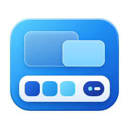

<p align="center">
  
</p>

<h1 align="center">SuperBar</h1>

<p align="center">
  <strong>A modern, customizable taskbar for Windows.</strong><br>
  Built with <strong>.NET 11</strong> and <strong>WinUI 3</strong> · for Windows 10 and Windows 11
</p>

<p align="center">
  <a href="https://github.com/Younesidk/SuperBar/releases/latest"><strong>Download the latest version</strong></a>
  ·
  <a href="https://superbar.younesidk.dev"><strong>Website</strong></a>
</p>

---

## What is SuperBar?

SuperBar replaces the Windows taskbar with one clean, continuous bar along the bottom of your screen. It keeps
everything you rely on, like the Start button, your pinned and open apps and the system area, and adds small
built-in widgets that show useful information at a glance.

It feels like a native part of Windows: maximized windows stop right above it, it comes in a light and a dark
look with a see-through acrylic background, and it gets out of the way when you play a game or watch a video
full-screen.

## Highlights

- **Everything in one bar.** Start, your pinned apps, your open windows, widgets and the system area, side by side.
- **Handy widgets.** A clock, live CPU and memory usage, and "Now Playing" with play/pause and next track for
  whatever music or video is playing.
- **Make it yours.** The Control Center lets you pin and reorder apps, choose and arrange widgets, and change
  how the bar looks (height, light or dark, transparency, accent color). Changes show up instantly.
- **Always safe to try.** When you close SuperBar, your normal Windows taskbar comes straight back. Even if
  something goes wrong, SuperBar puts it back the next time it starts.
- **Stays up to date.** SuperBar checks for updates and installs them for you with one click.
- **Light and fast.** Widgets pause while you are in a full-screen game or video, so they don't cost you
  performance.

## Get SuperBar

1. Download **`SuperBar-win-Setup.exe`** from the [latest release](https://github.com/Younesidk/SuperBar/releases/latest).
2. Run it. It installs just for you, with no admin rights needed, and starts SuperBar right away.

You can also learn more and download SuperBar from the website: **[superbar.younesidk.dev](https://superbar.younesidk.dev)**.

> Windows may show a SmartScreen warning the first time, because the installer is not code-signed yet.
> Choose **More info → Run anyway** to continue.

**Using SuperBar:** right-click an empty part of the bar to open the **Control Center** or to exit. In the
Control Center you can also turn on **Start with Windows**, and check for updates under **About**.

**Uninstalling:** remove SuperBar from **Settings → Apps → Installed apps** like any other app. Your
Windows taskbar is restored automatically.

## Where SuperBar is today

SuperBar is in its first release (**version 0.1**). The core experience works on a real desktop today, and more
is on the way:

- Icons from other apps in the system tray, right inside the bar
- Window previews when you hover over an app
- Drag-and-drop to rearrange apps directly on the bar
- A bar on every monitor, a bar at the top of the screen, and auto-hide
- More widgets, such as a calendar and weather

---

## For developers

Everything below is the technical detail: how to build SuperBar, how it is put together, and how it replaces the
taskbar safely.

SuperBar is written in C# on **.NET 11** with **WinUI 3** (Windows App SDK). It registers itself as a shell AppBar,
so it reserves its screen space like the real taskbar does, and it hides the native taskbar while it runs.

> **Status: foundation milestone (0.1).** The architecture, the Windows shell integration, the runtime, the widget
> system and the Control Center are in place and work on a real desktop. Most features listed under
> *Not implemented yet* are still to come.

### Build, run, test

```powershell
dotnet build SuperBar.slnx -p:Platform=x64      # or -p:Platform=ARM64
dotnet test --project tests/SuperBar.Tests
src/SuperBar.App/bin/x64/Debug/net11.0-windows10.0.19041.0/win-x64/SuperBar.exe
```

Requirements: the .NET 11 SDK on Windows 10 1809 (build 17763) or later. SuperBar is an **unpackaged** desktop app
that carries the Windows App SDK runtime with it (`WindowsAppSDKSelfContained`), so nothing else needs to be installed
and it can be shipped with Velopack. The WinUI projects build per architecture (x64 or ARM64); a plain
`dotnet build SuperBar.slnx` (Any CPU) builds them as x64.

| Switch | Effect |
|---|---|
| `--control-center` | Opens the Control Center on start-up |
| `--restore-taskbar` | Restores a native taskbar left hidden by a crashed session, then exits |
| `--verbose` | Debug-level logging |

Right-click an empty part of the bar to open the Control Center or exit. Exiting always restores the Windows taskbar.

Data lives in `%LOCALAPPDATA%\SuperBarData\`: `settings.db` (SQLite), `taskbar-recovery.json` and `logs\`. It is deliberately not `%LOCALAPPDATA%\SuperBar\`: that is the install folder, which the installer replaces on install and repair and removes on uninstall. Data left there by a build older than 0.1.0 is moved over on the first start.

### Install, update, release

SuperBar ships as a [Velopack](https://velopack.io) installer (`SuperBar-win-Setup.exe`, per user, no admin rights) published on GitHub Releases. The installed app lives in `%LOCALAPPDATA%\SuperBar\current\`; an update replaces the contents of `current`, so the path of `SuperBar.exe` never changes.

- **Updates.** Control Center → About checks the repository's GitHub Releases, downloads the update (a delta when there is one) and restarts into it. `IUpdateService` (`VelopackUpdateService`) owns the state; a development build reports "not installed" and does nothing.
- **The taskbar is always restored first.** "Restart to update" starts the updater and then exits SuperBar in order, which restores the Windows taskbar. Should SuperBar be killed instead (the uninstaller does that), the `InstallerHooks` that Velopack runs before an update and before an uninstall restore it from the recovery record. The uninstall hook also removes the "Start with Windows" entry.
- **Start with Windows** (Control Center → General) is the value `SuperBar` under `HKCU\Software\Microsoft\Windows\CurrentVersion\Run`. `StartWithWindowsSync` keeps it in line with the setting, at start-up and on every change. Development builds never register themselves.

To release, from a clean commit that is pushed to GitHub:

```powershell
.\scripts\release.ps1 -Version 0.1.0 -DryRun     # build + pack only: artifacts\releases\SuperBar-win-Setup.exe
.\scripts\release.ps1 -Version 0.1.0             # also tags v0.1.0 and creates the GitHub release
```

The script publishes self-contained for win-x64, packs with `vpk` (a local dotnet tool pinned in `dotnet-tools.json` to the version of the Velopack package), and uploads the installer, the portable zip, the feed files (`releases.win.json`, `RELEASES`, `assets.win.json`) and that version's `.nupkg` packages. From the second release on it first downloads the previous one, so a delta package is built. `-Notes` / `-NotesFile` set the release notes; `-SkipGitTag` lets GitHub create the tag. The installer is not code-signed, so Windows SmartScreen warns on first run.

### Solution structure

| Project | Responsibility | Depends on |
|---|---|---|
| `SuperBar.App` | Entry point, Velopack hook, single instance, crash safety nets, DI composition, lifecycle | everything |
| `SuperBar.Runtime` | WinUI 3: the taskbar window, theme, zone layout, section view models, widget views and hosting, AppBar/taskbar coordination | Core, Widgets |
| `SuperBar.Core` | Domain models, settings model and normalization, layout math, **shell integration interfaces**, UI-thread abstraction (`IUiDispatcher`) | – |
| `SuperBar.Windows` | Win32 P/Invoke: AppBar, native taskbar hide/restore, window tracking, icons, launching, shell shortcuts, monitors, CPU/RAM, window chrome | Core |
| `SuperBar.Widgets` | Widget contract, descriptors, registry, lifecycle host, built-in widget controllers and models (UI-framework free) | Core |
| `SuperBar.ControlCenter` | WinUI 3: the separate settings window (Mica, navigation pane) | Core, Widgets |
| `SuperBar.Infrastructure` | SQLite settings store, settings service, recovery store, Serilog | Core |
| `tests/SuperBar.Tests` | xUnit v3 tests for the pure logic, run headlessly (no UI thread) | Core, Infrastructure, Windows, Widgets |

The UI projects (`Runtime`, `ControlCenter`) never reference `SuperBar.Windows`. They talk to Windows only through the interfaces in `SuperBar.Core.Shell` (`IAppBarService`, `INativeTaskbarController`, `IWindowTracker`, `IShellCommands`, …), so the shell integration can evolve on its own.
Window-chrome tweaks WinUI cannot express (tool-window style, no DWM rounded corners, no minimum-size clamp,
showing without activation) go through `IWindowChrome` too; the only Win32 interop in the UI projects is getting
the window handle (`WindowNative.GetWindowHandle`).

Only `SuperBar.App`, `SuperBar.Runtime` and `SuperBar.ControlCenter` reference WinUI. Widgets expose a plain
presentation model (the taskbar renders it with the view marked `[WidgetViewFor(typeof(TModel))]`), and timers go
through `IUiDispatcher`, so the widget system is tested without a UI thread.

### How the taskbar replacement works

An ordinary borderless window at the bottom of the screen is not a taskbar: maximized windows cover it and the real taskbar stays visible. SuperBar does three things to behave like a taskbar:

**1. It registers as a shell AppBar** (`SuperBar.Windows/AppBar`).
`ABM_NEW` registers the bar window with a callback message. `ABM_QUERYPOS` and `ABM_SETPOS` then negotiate a full-width strip on the bottom edge, in physical pixels (height in DIPs × the monitor's DPI scale). The shell shrinks the desktop work area, so maximized windows stop at the bar.
The bar window is subclassed with `SetWindowSubclass` for three reasons:
- The AppBar contract requires it to forward `WM_ACTIVATE` and `WM_WINDOWPOSCHANGED` to the shell.
- It must react to `ABN_POSCHANGED`, by re-negotiating its position.
- It must react to `ABN_FULLSCREENAPP`: it drops "topmost" and suspends widgets while a game or video is full-screen.

`WM_DPICHANGED` and `WM_DISPLAYCHANGE` (debounced) trigger a new negotiation. `ABM_REMOVE` runs on exit.

**2. It hides the native taskbar safely** (`SuperBar.Windows/Taskbar`).
Registering an AppBar does *not* hide `Shell_TrayWnd`, and a merely hidden taskbar still reserves its work-area space. So SuperBar:
1. Writes a recovery record (`taskbar-recovery.json`) **before** changing anything.
2. Switches the native taskbar to auto-hide with `ABM_SETSTATE`, only if it isn't already, so it stops reserving space.
3. Hides it with `ShowWindow(SW_HIDE)`. This change is not persistent: Explorer undoes it whenever it restarts.
4. Keeps it hidden by listening for `EVENT_OBJECT_SHOW` on the taskbar window through an event hook (no polling).
5. On exit, restores the original auto-hide state, shows the taskbar and deletes the record.

Explorer is never killed or restarted, and the registry is never edited directly. The only persisted change is the auto-hide flag, set through the official API and always reverted.

**3. It survives shell events.**
A hidden listener window receives the `TaskbarCreated` broadcast when Explorer restarts. SuperBar then hides the new taskbar again and re-registers its AppBar, which the shell forgets when Explorer restarts.

#### Crash safety

| Situation | What happens |
|---|---|
| Normal exit (menu, Control Center, `Shutdown`) | Full restore |
| Unhandled exception / process exit | `AppDomain` handlers run the same restore |
| Hard kill (`End task`) | No code can run. The taskbar reappears on its own once SuperBar's hook dies (verified on Windows 11). If SuperBar had switched on auto-hide, auto-hide stays on until the next SuperBar start or `--restore-taskbar`, which read the recovery record and revert it |
| Faulty widget | It is isolated behind an error placeholder; the bar keeps running |

#### Known limitations of this approach

- Only the **primary monitor** gets a SuperBar. Secondary-monitor taskbars stay native. They follow the auto-hide setting while SuperBar runs. The model and AppBar options already carry a monitor handle for per-monitor bars.
- Start, Quick Settings (Win+A), Notification Center (Win+N) and Task Manager are opened by sending their system shortcuts. They are Explorer/ShellExperienceHost surfaces and are not re-implemented.

### Widgets

A widget is two classes and no registration code:

- **Logic** in `SuperBar.Widgets/BuiltIn/<Name>/`: a class marked `[Widget("superbar.<name>", "Display name", ...)]` that derives from `WidgetBase` (or `WidgetBase<TSettings, TModel>` for typed settings), plus its presentation model. It is created with constructor injection.
- **View** in `SuperBar.Runtime/Widgets/<Name>/`: a `WidgetViewBase` marked `[WidgetViewFor(typeof(TModel))]`.

Both are discovered by their attribute at start-up. Instances are configured in settings (`WidgetInstanceSettings`: id, type, enabled, width, options) and placed by layout entries.

`WidgetHost` owns each instance and runs this lifecycle: create → load settings (silently) → `InitializeAsync` once → `Ready` ⇄ `Active`. A widget is active only while the bar is visible and no full-screen app runs.

While active, a widget starts all of its work through the `IWidgetScope` it receives:

| Member | Use |
|---|---|
| `Every`, `After` | Timers on the UI thread |
| `Poll`, `Run` | Work on the thread pool with a timeout; only the result returns to the UI thread |
| `Own` | Hooks and subscriptions to release |

The scope ends on deactivation, so nothing has to be stopped by hand. Views talk back through `WidgetCommand`s on the model, which the widget wires with `On(Model.Command, handler)`.

Settings and state:

- **Settings** are a plain class, the `TSettings` of `WidgetBase<TSettings, TModel>`. Properties marked `[Setting("Label", ...)]` appear in the Control Center as a generated form (switch, slider or number box, drop-down, text box). Edits reach the running widget live through `OnSettingsChanged`, and the widget can change its own settings with `SaveSettings(s => ...)`. They are stored as typed JSON in the instance's `options`; values saved as strings by older versions are still read.
- **Custom editor:** a WinUI view in SuperBar.ControlCenter marked `[WidgetSettingsViewFor(typeof(TSettings))]` replaces the generated form for that settings class.
- **State** that is not a setting (a running countdown, a cached value) goes to `Context.State`. It is kept in its own row (`widget-state:{instanceId}`), so saving it never re-lays out the bar.

Fault isolation: every call into a widget is guarded. A widget that throws (in a lifecycle method, a timer tick, a result handler or a command) is disposed and replaced by an error placeholder, then restarted after 30 s, 2 min and 10 min; after that a click on the placeholder restarts it. Failing or hanging background work is retried with back-off and does not fault the widget.

Widgets render **inside** the bar's layout. They never get their own window. The built-in widgets are `ClockWidget`, `SystemResourcesWidget` (CPU and memory, sampled every 2 s while active) and `MediaWidget` ("Now Playing": the current Windows media session, with Play/Pause and Next).

### Settings

`ISettingsService` publishes immutable snapshots. `Update` clones the current snapshot, applies the change, normalizes it (clamps values, drops dangling references, guarantees Start and Applications sections), saves it, swaps it in, and raises `Changed`. The runtime applies changes live.
Storage is SQLite, with one JSON document per area (`appearance`, `behavior`, `layout`, `widgets`, `pinnedApps`). A corrupt area resets alone.
The recovery record is deliberately a plain JSON file, so it works even if the database is unavailable.

### Not implemented yet

- **Notification-area (tray) icons.** Hosting other apps' tray icons requires implementing the shell's `Shell_TrayWnd` notification protocol. Until then the overflow chevron opens Explorer's own "hidden icons" flyout (via Win+B, then moved next to the bar), so icons shown directly on the native taskbar are not visible in SuperBar.
- Window thumbnails/previews. Grouped windows currently cycle on click.
- `.lnk` target resolution for matching shortcuts to running apps. Jump lists. (Pinning and unpinning work from the bar's right-click menu and from the Control Center's Applications page.)
- Drag-and-drop reordering on the bar. The Control Center already supports reorder and zone changes.
- Per-monitor bars, top-edge placement, auto-hide for SuperBar itself.
- Code signing of the installer, and an ARM64 release (the release script packs win-x64 only).
- More widgets (calendar, weather, session statistics).
- UWP/packaged apps are grouped by `ApplicationFrameHost` and may not group perfectly.
